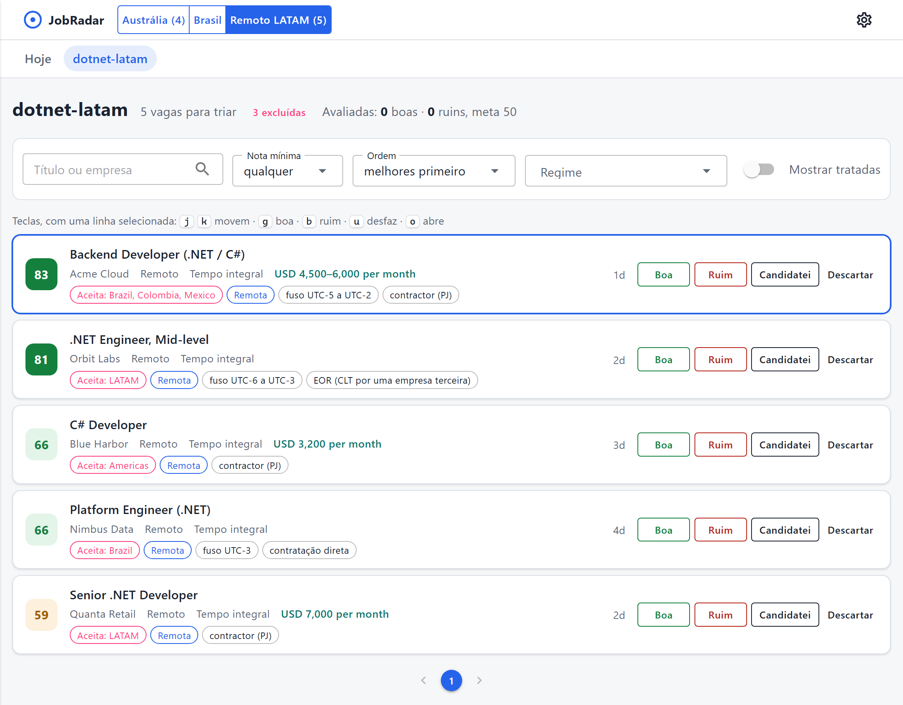
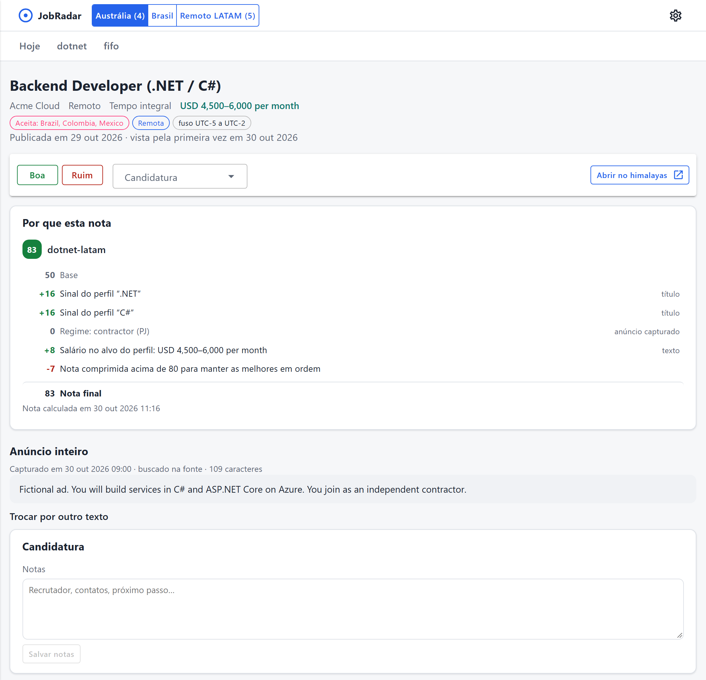
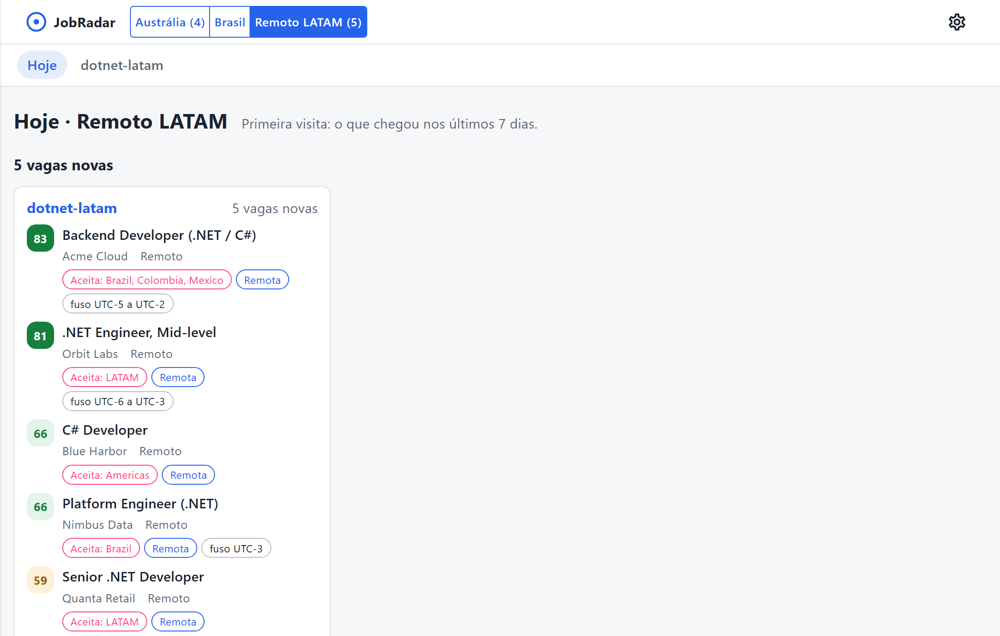

# JobRadar

Tracks the Australian job market for people arriving on a Working Holiday visa (subclass 417/462):
which jobs they can actually take, and how the market moves month to month.

Two products share one core:

- **Matching** (private): ranks new listings against a candidate profile, explains every score,
  and tracks applications.
- **Market snapshot** (public): aggregated numbers only, such as listings per city and area,
  the share that accepts working holiday makers, and the share that requires citizenship or PR.
  It feeds a monthly newsletter in Portuguese for Brazilians moving to Australia.

> **Status:** v1 running in production since October 2026. Daily collection from Seek, full-text clause
> detection, full ad text for the listings that matter, scoring per profile, application tracking, a
> triage UI and the monthly market snapshot work end to end; the scorer matches the Python prototype on
> 5,388 real listings. Left for v1: importing the prototype history.
> Scope: [docs/visao.md](docs/visao.md) · roadmap: [docs/plano.md](docs/plano.md) (Portuguese).







The interface is in Portuguese (the author's language); code, docs for contributors and this README are in English.

<sub>Screenshots use fictitious listings and the example profile from
`src/JobRadar.Worker/appsettings.Local.example.json`.</sub>

## Architecture

```
src/
  JobRadar.Domain           pure model: listings, locations, work types (no EF, no HTTP)
  JobRadar.Application      business services + ports (Abstractions/) they depend on
  JobRadar.Infrastructure   EF Core: entity → configuration → mapper → repository, one model for both databases
  JobRadar.Infrastructure.Migrations.Postgres / .SqlServer   migrations per provider
  JobRadar.Integrations.Seek  Seek search API: resilient HTTP client, translator to the neutral model
  JobRadar.Worker           composition root, daily pipeline and CLI commands
  JobRadar.Web              triage UI (Blazor, server rendering)
tests/
  *.Domain.Tests            pure unit tests
  *.Infrastructure.Tests    mapper tests + repository contract tests on real Postgres and SQL Server (opt-in)
  *.Worker.Tests            DI composition: the container builds and every port is registered
```

- Dependencies point inward; one project per layer lets the compiler enforce it.
- Repositories answer business questions and return domain models, never EF entities or `IQueryable`.
- Each job site will be an integration translating its data into the neutral `Listing`;
  the core never knows which site a listing came from. See [docs/fontes.md](docs/fontes.md).

## Running locally

Requires the .NET 10 SDK and Docker.

```bash
docker compose up -d
dotnet tool restore
dotnet ef database update --project src/JobRadar.Infrastructure.Migrations.Postgres
dotnet run --project src/JobRadar.Worker
```

Describe your profiles first: copy `src/JobRadar.Worker/appsettings.Local.example.json` to
`appsettings.Local.json` (git-ignored). Every day at 06:00 Perth time the worker searches each
profile's keywords in its locations, then scores what each profile found. Set
`Collection__RunOnStartup=true` to run a pass immediately.

Triage in the browser at http://localhost:5380:

```bash
dotnet run --project src/JobRadar.Web
```

Each profile gets a queue, best score first, with the same job posted several times shown once.
Mark a listing good or bad, applied or dismissed from the list; the detail page explains the score
rule by rule from the base of 50 and keeps notes and the application history. The site has no
login yet and only listens on localhost.

The worker executable also takes commands:

```bash
dotnet run --project src/JobRadar.Worker -- status seek:81234567 applied
dotnet run --project src/JobRadar.Worker -- label seek:81234567 good "exactly my stack"
dotnet run --project src/JobRadar.Worker -- calibrate
```

`calibrate` reports, per profile, how often a listing you liked outscores one you did not, and
lists where the score disagrees with you, with the rules that weighed most.

### Market snapshot (Raio-X)

Every day the worker also counts open listings per official Seek category and city, and how many
mention terms such as "sponsorship" or "working rights" anywhere in the ad. Each daily snapshot is
checked (failed counts, cut listings, implausible swings) and only good ones feed the monthly
report, written in Portuguese for the newsletter:

```bash
dotnet run --project src/JobRadar.Worker -- market-report 2026-10 raio-x_2026-10.md
```

The report holds aggregates only: counts, shares, salary medians. Never an individual listing.

### Choosing the database

Postgres is the default and what production runs. SQL Server works the same, behind the same EF Core
model: `Database:Provider` picks it, and each provider has its own migrations.

```bash
docker compose --profile sqlserver up -d sqlserver
JOBRADAR_CONNECTION="Server=localhost,1433;Database=jobradar;User Id=sa;Password=JobRadar-local-1;TrustServerCertificate=True" \
  dotnet ef database update --project src/JobRadar.Infrastructure.Migrations.SqlServer
Database__Provider=SqlServer ConnectionStrings__JobRadar="Server=localhost,1433;..." dotnet run --project src/JobRadar.Web
```

Let the migrations create the database: the case- and accent-sensitive collation that makes SQL Server
behave like Postgres only applies to a database they create. To bring real data across, `copy-database`
copies every row of the configured database into another one, empty and migrated:

```bash
dotnet run --project src/JobRadar.Worker -- copy-database SqlServer "Server=localhost,1433;..."
```

## Production

Everything runs in containers with `docker compose --profile prod` (Postgres, a one-shot migration job, the
worker and the site), the same on Windows, Linux or macOS; the deploy scripts are PowerShell 7 and call only
`docker compose`, `git` and `dotnet`. Machine settings live in a `.env` (see `deploy/prod.env.example`). A push to
main with green CI is deployed by `deploy/auto-deploy.ps1`; the scoring parity check runs first. The worker waits
for the database and catches up on a run missed while the machine was off; the site listens on localhost and the
Tailscale address only. See [docs/producao.md](docs/producao.md) (Portuguese).

## Observability

The daily pass is one trace, with a span per stage and per search, and metrics for what each search found, what was
new, what failed and how long each stage took (`JobRadarTelemetry`). Nothing is collected unless an OTLP endpoint is
configured; locally, the Aspire dashboard shows it all:

```bash
docker compose --profile telemetry up -d aspire
Telemetry__OtlpEndpoint=http://localhost:4317 Collection__RunOnStartup=true dotnet run --project src/JobRadar.Worker
```

Then open http://localhost:18888.

## Tests

```bash
dotnet test
```

Contract tests are written once and run against a real Postgres 18 and a real SQL Server 2022, each in a
container; they are skipped unless `JOBRADAR_DB_TESTS=1`:

```bash
JOBRADAR_DB_TESTS=1 dotnet test
```

## Data and ethics

Only aggregated numbers are published, never individual listings. The system does not bypass
anti-bot protection and does not open protected job pages. Ad text, for the listings that score well,
comes from the same data endpoint the source's own site uses; the first refusal stops that stage.
Requests identify the bot in the User-Agent, share one paced budget (a few per second), and back off
on HTTP 429. Ad text stays in the owner's database for personal use.

## License

[MIT](LICENSE)
